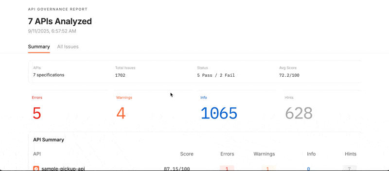

# API Governance Demo



## Overview

**Reference implementation** of an automated API governance and dashboarding system that integrates **Postman Spec Hub**, **API Builder**, **CI/CD pipelines** (Azure DevOps or GitHub Actions), **Slack notifications** and **Microsoft Teams notifications**. Demonstrates transformation of API governance from "A week of review" to "automatic quality gate in 20 minutes" using real Public API specifications from various industries.

All components tested end-to-end with real data.

## Project Structure

```
governance-demo/
├── .azure/                          # Azure DevOps Pipeline yaml
├── .github/                         # Github Actions Workflow yaml
├── governance-rules-and-functions/  # Custom governance rules and functions
│   ├── ****.js                      # Custom functions to be used in your demo team
│   └── postman-governance-rule.yml  # Custom governance rules for your demo team
├── scripts/                         # Scripts used by automation
│   ├── postman_governance-local.js  # Lint against local spec files for demo purposes
│   ├── postman_governance-spec.js   # Lint against Postman Spec Hub (default mode)
│   ├── postman_governance-api.js    # Lint against Postman APIs
│   ├── sync_specs_to_postman.js     # Sync local or repo specs to Postman Spec Hub
│   ├── sync_apis_to_postman.js      # Sync local or repo specs to Postman APIs
│   └── [other scripts]              # Notification and utility scripts
├── specs/                           # Real Public API specifications
├── governance-dashboard.html        # Governance dashboard (auto-generated)
├── SETUP-***.md                     # Configuration guides for various platforms
├── .env.example                     # Copy, rename ".env", and fill in your config for local demoing
├── TECHNICAL.md                     # Technical documentation
└── README.md                        # This documentation
```

---

## Why This Matters

Every day, development teams wait weeks for API approvals while quality standards vary between reviewers. By the time issues surface, they're in production. This demo changes that conversation.

**What you'll show them:**
- APIs automatically scored in real-time
- Quality gates that prevent bad APIs from reaching production
- Executive dashboards that surface quality metrics instantly
- Integration with their existing CI/CD pipelines

**The transformation:**
- Before: 1-2 weeks of manual reviews, inconsistent standards, production issues
- After: 20 minutes of automated scoring, consistent enforcement, issues caught early

## Get Your Demo Running in 10 Minutes

### Step 1: Get Your Postman Credentials

First, grab your Postman API credentials:
- Log into your Postman account
- Go to https://go.postman.co/settings/me/api-keys
- Click "Generate API Key" and copy it
- Visit any workspace and copy the workspace ID from the URL

The workspace ID looks like this in your browser:
```
https://app.getpostman.com/workspace/12345678-1234-1234-1234-123456789abc
```
Your ID is: `12345678-1234-1234-1234-123456789abc`

### Step 2: Set Up Your Demo Repository

**GitHub (Recommended)**
1. Fork this repository to your GitHub account
2. Go to Settings → Secrets and variables → Actions
3. Add these secrets:
   - `POSTMAN_API_KEY`: Your API key from Step 1
   - `WORKSPACE_ID`: Your workspace ID

**Azure DevOps Alternative**
1. Create a new Azure DevOps project and import this repository
2. Go to Pipelines → Library → + Variable group
3. Create group named `postman-secrets` with the same credentials (mark API key as secret)

### Step 3: Create Your Pipeline/Workflow

Now you need to set up the actual automation pipeline:

**GitHub Actions**
1. In your forked repository, go to the **Actions** tab
2. If Actions are disabled, click "I understand my workflows, go ahead and enable them"
3. You should see "Postman Governance" workflow listed
4. If you don't see any workflows, click "New workflow" → "Set up a workflow yourself" and copy the content from `.github/workflows/postman-governance.yml` in your repo

**Azure DevOps**
1. In your Azure DevOps project, go to **Pipelines** → **Create Pipeline**
2. Choose "Azure Repos Git" and select your repository
3. On the "Configure" tab (showing Node.js, Express, etc. templates), scroll down and select **"Existing Azure Pipelines YAML file"**
4. Choose the path: `/.azure/pipelines/postman-governance.yml`
5. Click "Continue" → "Save and run"

The pipeline should now be ready to trigger when you make changes.

### Step 4: Run Your First Demo

Make any small change to a file in the `specs/` folder - add a comment, change a description, anything. Commit and push the change. Watch the magic happen in the Actions/Pipelines tab.

## How to Demo This to Clients

### Option 1: Live Demo During Your Call

**The Setup (30 seconds)**
"I'm going to show you how Postman transforms API governance. Here we have real API specifications from companies like PayPal, Stripe, and GitHub."

**The Trigger (1 minute)**
Make a visible change to one of the API specs. "I'll simulate a developer submitting a new API for review."

**The Automation (3 minutes)**
Navigate to Actions/Pipelines and watch it run. "Watch as Postman automatically scores these APIs using your governance standards."

**The Results (2 minutes)**
Download and show the governance dashboard. "In under 5 minutes, we have a complete governance report that took weeks before."

**The Integration Point (1 minute)**
"This works with whatever CI/CD pipeline you're already using. Teams get immediate feedback, management gets dashboards, and nothing reaches production without meeting your standards."

### Option 2: Pre-Run the Demo

If you prefer not to run live during client calls:
1. Run the demo beforehand
2. Download the governance dashboard HTML file
3. Show the pre-generated results during your presentation
4. Walk through the pipeline logs to demonstrate the automation

## What They'll See

### The Governance Dashboard
Each API gets scored out of 100 with detailed breakdowns of violations, pass/fail status based on configurable thresholds, and click-through buttons to Postman.

### The Pipeline in Action
- Push a new spec file to the repo or push a change? The pipeline utomatically creates/updates the spec in Postman and syncs the related collections.
- Push a spec that doesn't meet the standard? The automated quality gates in the pipelines can fail the build when APIs don't meet standards.
- Real-time notifications are sent to Slack/Teams
- Dashboards are generated as HTML or JSON for management to review.

## Customize the Demo for Your Clients

### Use Their Actual APIs
Save your client's specifications files in the `specs/` folder and run the demo with their real data. This shows exactly how their APIs score against industry standards.

### Adjust Quality Standards
Edit the governance threshold in `.github/workflows/postman-governance.yml` or `.azure/pipelines/postman-governance.yml`. Higher thresholds (80-90) show stricter governance, lower ones (50-60) show a more lenient approach. For you can also adjust the weights for ERROR, WARN, ISSUE, and HINT statuses in the postman_governance-***.js files (I should probably abstract this out into variables at some point)

### Control Pipeline Behavior
Add `FAIL_ON_GOVERNANCE_VIOLATIONS=false` as a repository variable to make pipelines succeed even when APIs don't meet standards. The dashboard still shows all violations - perfect for showing governance data without intimidating red X's in your demo.

### Tailor Governance Rules
Governance rules are configured directly in Postman. Go to Home > API Governance, create or modify governance rules, and apply them to specific workspace groups. This lets you show clients how governance standards can be customized per team or API type - all managed centrally in Postman.

### Advanced: Specs mode or APIs Mode
The system supports different modes (specs vs APIs) but defaults to the recommended specs mode. Most CSMs should stick with the default. For advanced demos, you can manually set "apis" mode in the variables on Azure/Github to show the APIs workflow.

## Common Demo Questions

**"Why are all my scores so low?"**
You probably have too many rules set. The "All workspaces" group in the cs-demo instance is set with a pretty fair set of rules, so just use that. It should be 12 rules and 4 functions -- if there are any more or less, someone's messed with it. You can rebuild by deleting everything and re-adding the things in the "governance-rules-and-functions" folder.

**"What if the pipeline fails during the demo?"**  
Perfect! Say: "This is exactly how the quality gate works. In the real world, this API wouldn't make it to production until these issues are fixed."

**"What if nothing runs?"**  
Show pre-generated results instead: "The key point is that this entire process is automated and integrates with your existing tools."

**"What if they ask technical questions you can't answer?"**  
"That's a great technical question. Let me connect you with our solutions engineer who can dive deep into the implementation details."

**"Can we add Slack/Teams notifications?"**  
Absolutely! Create a webhook in your demo channel and add `SLACK_WEBHOOK_URL` or `TEAMS_WEBHOOK_URL` as secrets. Show real-time notifications during the demo.

**"The pipeline isn't running"**  
GitHub Actions might be disabled. Go to Settings → Actions → General → Allow all actions.

**"Getting API key errors"**  
Generate a fresh API key in Postman and update the secret. Make sure the secret name matches exactly.

## ROI Discussion Points

**Time Savings**: 95% reduction from 1-2 weeks to 20 minutes per API review

**Quality Improvements**: Consistent automated enforcement vs. inconsistent human standards  

**Developer Productivity**: Immediate feedback vs. long feedback loops and waiting

**Compliance**: Automated audit trails vs. manual oversight challenges

## Your Next Move

1. Pick a client struggling with API quality or slow release cycles
2. Set up this demo with their actual API specifications
3. Show them the transformation from weeks to minutes
4. Schedule the technical follow-up to discuss implementation

**Additional Resources**
- Public Workspace: https://www.postman.com/r00tfs/governance-demo/overview
- Setup Guides: See SETUP-*.md files in this repository
- Postman Documentation: https://learning.postman.com/docs/api-governance/

---

*Built for CSMs who want to show real value. Questions? Just ask!*
